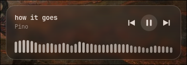

spotglass - small glass music player widget (in wayland)

shows title/artist, prev/play/next, and a bar visualizer. sits behind your windows or in front of them.

needs: wayland, pipewire, cairo, pango, glib, gdk-pixbuf, wayland-protocols, wayland-scanner, a C compiler

    make
    make install            # to ~/.local/bin, or: sudo make install PREFIX=/usr/local

usage:

    spotglass               open it (in front). run again to toggle front/back
    spotglass --spotify     only follow spotify, quit when spotify closes
    spotglass --quit        close it
    right-click the widget  close it

bind `spotglass` to a key, e.g. mango: `bind=CTRL+ALT,m,spawn,spotglass`

to have it come up with spotify, launch spotify like this:

    sh -c 'spotglass --spotify & exec flatpak run com.spotify.Client'

the glass background is your wallpaper blurred, read from `awww query` / `swww query`. other wallpaper tools just get a plain dark tint.

size, corner, colour, font etc are #defines at the top of spotglass.c

Note: assisted and barely tested, don't trust it till next update
